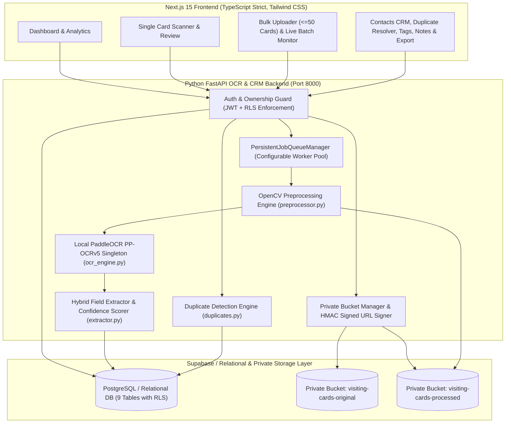

# CardFlow System Architecture

## 1. High-Level Architecture Overview

CardFlow strictly separates presentation and CRM workflows (**Next.js App Router frontend**) from CPU-intensive computer vision, OCR, and background job orchestration (**Python FastAPI microservice**), while enforcing strict multi-tenant data isolation via **Supabase PostgreSQL Row Level Security (RLS)** and **Private Storage Buckets**.

---

## 2. Separation of Responsibilities

### 2.1 Next.js Frontend (`src/`)
- **Zero Direct OCR Execution**: The frontend never executes OCR or stores raw filesystem paths. It communicates via typed REST calls (`src/lib/api.ts`) and renders short-lived HMAC-signed image URLs (`original_image_url`, `processed_image_url`).
- **Interactive Verification UX**: Displays original vs. OpenCV-preprocessed images, bounding-box segments with reading order, and dual confidence badges (`ocr_confidence` and `classification_confidence`) so the user can verify low-confidence fields before saving.
- **Communication & Export**: Generates WhatsApp (`https://wa.me/`), Email (`mailto:`), and Call (`tel:`) actions and streams formula-safe CSV/Excel exports.

### 2.2 Python FastAPI Backend (`backend/app/`)
- **OpenCV Preprocessing (`services/preprocessor.py`)**:
  - Preserves the user's original uploaded image untouched in `visiting-cards-original`.
  - Applies EXIF/manual rotation, Canny contour card-boundary detection and 4-point perspective warp (when card occupies >= 22% of frame), Hough-line deskewing (`<= 15°`), optimal aspect-ratio scaling (`max_dim = 1600px`), dark-background inversion (`mean_luminance < 85`), bilateral edge-preserving denoising, LAB-space CLAHE contrast enhancement, and unsharp masking.
- **Local PaddleOCR Singleton (`services/ocr_engine.py`)**:
  - Loads cached `PP-OCRv5_server_det` and `PP-OCRv5_server_rec` models once into memory and protects inference with a thread lock (`_infer_lock`).
  - Disables OneDNN/MKLDNN dynamic shape caching bugs on Windows CPU (`FLAGS_use_mkldnn=0`) for deterministic stability across variable-aspect-ratio cards.
  - Sorts detected polygons into natural top-to-bottom, left-to-right reading order using 14-pixel row banding.
- **Hybrid Information Extraction (`services/extractor.py`)**:
  - Completely decoupled from OCR character recognition.
  - Combines deterministic regular expressions (phone, email, website, LinkedIn, Indian 6-digit PIN and US ZIP), configurable dictionaries (`config_dictionaries.json`), and 2D spatial heuristics (font-height estimation from bounding-box vertical span, top/middle/bottom zone classification, and CamelCase token splitting).
  - Never fabricates or guesses missing fields.

### 2.3 Persistent Background Queue (`services/queue_worker.py`)
- **Non-Blocking Bulk Uploads**: Uploading a batch of up to 50 cards writes the files to `visiting-cards-original`, creates `scan_batches` and `card_scans` rows in status `queued`, enqueues the scan IDs into `PersistentJobQueueManager`, and immediately returns HTTP 200 (`< 1s`).
- **Configurable Concurrency**: Controlled via `MAX_CONCURRENT_OCR_WORKERS` (default `3`).
- **Crash Recovery**: On application startup (`lifespan`), `_recover_unfinished_jobs()` queries all `card_scans` left in `uploaded`, `queued`, or `processing` state and re-enqueues them automatically.
- **Idempotent Contact Saving**: Both single-card save and `POST /api/v1/batches/{batch_id}/bulk-save` check `ContactModel.scan_id == scan.id` before inserting, preventing duplicate contacts when batches or scans are retried.

---

## 3. Security & Multi-Tenant Isolation

1. **Row Level Security (RLS) & Ownership Validation**:
   - SQL migrations (`supabase/migrations/00002_rls_policies.sql`) define `auth.uid() = user_id` and `public.user_is_org_member(organization_id)` policies across all 9 tables.
   - Every backend endpoint resolves the authenticated user solely from the verified `Authorization: Bearer <jwt>` token (`get_current_user` in `backend/app/auth.py`) and filters every query by `user_id == current_user.id`. Client-supplied `user_id` parameters are never trusted.
2. **Private Storage Buckets & Signed URLs**:
   - Both `visiting-cards-original` and `visiting-cards-processed` are private buckets (`public = false`).
   - Objects are stored under `{user_id}/{scan_id}/{filename}`.
   - Image URLs returned to the browser are signed with HMAC-SHA256 (`verify_signed_url` in `backend/app/storage.py`) and expire after `SIGNED_URL_TTL_SECONDS` (default 3600 seconds). Tampering with any query parameter (`bucket`, `path`, `exp`, `sig`) immediately returns `HTTP 403 Forbidden`.
3. **Upload Validation**:
   - Validates file extension (`.jpg`, `.jpeg`, `.png`, `.webp`), MIME type, non-empty payload, maximum file size (`<= 10 MB`), maximum batch count (`<= 50 files`), and verifies that OpenCV can decode the image header before saving.

