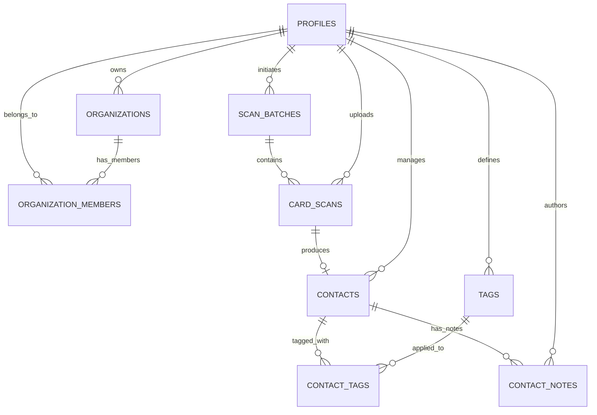

# CardFlow – Database Schema & Storage Architecture

CardFlow uses PostgreSQL (via Supabase) with Row Level Security (RLS) enabled across all 9 domain tables and private folder-scoped storage buckets.

## 1. Entity-Relationship Overview

---

## 2. Tables

### 2.1 `profiles`
Stores authenticated user details linked 1:1 with `auth.users(id)`.
- `id` (`UUID`, PK, FK → `auth.users.id ON DELETE CASCADE`)
- `full_name` (`TEXT`)
- `email` (`TEXT`, NOT NULL)
- `avatar_url` (`TEXT`)
- `created_at` (`TIMESTAMPTZ`, NOT NULL, DEFAULT `NOW()`)
- `updated_at` (`TIMESTAMPTZ`, NOT NULL, DEFAULT `NOW()`)

### 2.2 `organizations`
Multi-tenant workspace support; a default workspace is automatically provisioned on user signup via `handle_new_user()`.
- `id` (`UUID`, PK, DEFAULT `gen_random_uuid()`)
- `name` (`TEXT`, NOT NULL)
- `owner_id` (`UUID`, NOT NULL, FK → `profiles.id ON DELETE CASCADE`)
- `created_at` (`TIMESTAMPTZ`, NOT NULL, DEFAULT `NOW()`)
- `updated_at` (`TIMESTAMPTZ`, NOT NULL, DEFAULT `NOW()`)

### 2.3 `organization_members`
Maps users to organizations with role-based permissions.
- `id` (`UUID`, PK, DEFAULT `gen_random_uuid()`)
- `organization_id` (`UUID`, NOT NULL, FK → `organizations.id ON DELETE CASCADE`)
- `user_id` (`UUID`, NOT NULL, FK → `profiles.id ON DELETE CASCADE`)
- `role` (`TEXT`, CHECK `IN ('owner', 'admin', 'member')`)
- `created_at` (`TIMESTAMPTZ`, NOT NULL, DEFAULT `NOW()`)
- Unique constraint: `(organization_id, user_id)`

### 2.4 `scan_batches`
Tracks bulk visiting card uploads (up to 50 cards per batch).
- `id` (`UUID`, PK, DEFAULT `gen_random_uuid()`)
- `user_id` (`UUID`, NOT NULL, FK → `profiles.id ON DELETE CASCADE`)
- `organization_id` (`UUID`, NULLABLE, FK → `organizations.id ON DELETE SET NULL`)
- `batch_name` (`TEXT`, NOT NULL)
- `total_images` (`INTEGER`, CHECK `0 <= total_images <= 50`)
- `completed_count` (`INTEGER`, DEFAULT `0`)
- `failed_count` (`INTEGER`, DEFAULT `0`)
- `pending_count` (`INTEGER`, DEFAULT `0`)
- `status` (`TEXT`, CHECK `IN ('pending', 'processing', 'completed', 'partially_completed', 'failed')`)
- `created_at` (`TIMESTAMPTZ`, NOT NULL, DEFAULT `NOW()`)
- `completed_at` (`TIMESTAMPTZ`, NULLABLE)

### 2.5 `card_scans`
Individual visiting card scan jobs, storing both raw PaddleOCR output (with bounding boxes and OCR confidence) and structured extraction output (with separate field-classification confidence).
- `id` (`UUID`, PK, DEFAULT `gen_random_uuid()`)
- `batch_id` (`UUID`, NULLABLE, FK → `scan_batches.id ON DELETE CASCADE`)
- `user_id` (`UUID`, NOT NULL, FK → `profiles.id ON DELETE CASCADE`)
- `organization_id` (`UUID`, NULLABLE, FK → `organizations.id ON DELETE SET NULL`)
- `original_image_path` (`TEXT`, NOT NULL)
- `processed_image_path` (`TEXT`, NULLABLE)
- `raw_ocr_text` (`TEXT`, NULLABLE)
- `ocr_output` (`JSONB`, NOT NULL, DEFAULT `'[]'::jsonb`) — Array of `{ text, bbox, polygon, confidence, reading_order }`
- `extracted_data` (`JSONB`, NOT NULL, DEFAULT `'{}'::jsonb`) — Structured contact fields
- `extraction_confidence` (`JSONB`, NOT NULL, DEFAULT `'{}'::jsonb`) — Per-field `{ ocr_confidence, classification_confidence, overall_confidence, level, needs_review }`
- `status` (`TEXT`, CHECK `IN ('uploaded', 'queued', 'processing', 'review_required', 'completed', 'failed')`)
- `error_message` (`TEXT`, NULLABLE)
- `retry_count` (`INTEGER`, NOT NULL, DEFAULT `0`)
- `created_at` (`TIMESTAMPTZ`, NOT NULL, DEFAULT `NOW()`)
- `processed_at` (`TIMESTAMPTZ`, NULLABLE)

### 2.6 `contacts`
Verified and saved CRM contacts.
- `id` (`UUID`, PK, DEFAULT `gen_random_uuid()`)
- `user_id` (`UUID`, NOT NULL, FK → `profiles.id ON DELETE CASCADE`)
- `organization_id` (`UUID`, NULLABLE, FK → `organizations.id ON DELETE SET NULL`)
- `scan_id` (`UUID`, NULLABLE, FK → `card_scans.id ON DELETE SET NULL`)
- `full_name`, `first_name`, `last_name`, `company_name`, `designation` (`TEXT`)
- `phone`, `alternate_phone`, `email`, `website` (`TEXT`)
- `address`, `city`, `state`, `postal_code`, `country` (`TEXT`)
- `education`, `linkedin_url` (`TEXT`)
- `additional_information` (`JSONB`, DEFAULT `'{}'::jsonb`)
- `notes` (`TEXT`)
- `created_at`, `updated_at` (`TIMESTAMPTZ`)

### 2.7 `tags` & 2.8 `contact_tags`
User-defined color-coded tags and many-to-many junction table.
- `tags`: `id` (`UUID`), `user_id` (`UUID`), `organization_id` (`UUID`), `name` (`TEXT`), `color` (`TEXT`), `created_at` (`TIMESTAMPTZ`), `UNIQUE(user_id, name)`
- `contact_tags`: `contact_id` (`UUID`, FK → `contacts.id`), `tag_id` (`UUID`, FK → `tags.id`), `PRIMARY KEY (contact_id, tag_id)`

### 2.9 `contact_notes`
Activity/interaction notes attached to a contact.
- `id` (`UUID`, PK)
- `contact_id` (`UUID`, FK → `contacts.id ON DELETE CASCADE`)
- `user_id` (`UUID`, FK → `profiles.id ON DELETE CASCADE`)
- `note` (`TEXT`, NOT NULL)
- `created_at`, `updated_at` (`TIMESTAMPTZ`)

---

## 3. Row Level Security (RLS) & Storage Security

- Every table has `ENABLE ROW LEVEL SECURITY`.
- Ownership is enforced strictly via `auth.uid() = user_id` or membership in `organization_id` via `public.is_org_member(organization_id)` / `public.is_org_admin_or_owner(organization_id)`.
- Client-supplied `user_id` values are never trusted without matching the authenticated JWT identity.
- Storage buckets `visiting-cards-original` and `visiting-cards-processed` are configured with `public = FALSE`, restricted to `image/jpeg`, `image/png`, `image/webp` up to 10 MB, and folder-scoped (`<user_id>/<scan_id>/<filename>`) so users can only generate signed URLs for their own images.

