# CardFlow – Local OCR & Hybrid Information Extraction Pipeline

CardFlow converts physical and digital visiting card images into structured CRM contacts using a **100% locally hosted computer vision and NLP pipeline** powered by **OpenCV** and **PaddleOCR (PP-OCRv5)**. No external generative AI or paid third-party OCR APIs (OpenAI, Gemini, Claude, Google Vision, AWS Textract) are used anywhere in the pipeline.

---

## 1. Architecture Overview

```mermaid
flowchart LR
    A["Original Card Upload (JPG/PNG/WEBP)"] --> B["Private Bucket: visiting-cards-original"]
    B --> C["OpenCV Preprocessing Pipeline"]
    C --> D["Private Bucket: visiting-cards-processed"]
    D --> E["PaddleOCR (PP-OCRv5 Local Weights)"]
    E --> F["Reading-Order & BBox Normalizer"]
    F --> G["Hybrid Information Extraction Engine"]
    G --> H["Separate OCR & Classification Confidence"]
    H --> I["Human Review / CRM Contact Storage"]
```

---

## 2. Stage 1: OpenCV Image Preprocessing (`backend/app/services/preprocessor.py`)

Before passing an image to PaddleOCR, `preprocess_card_image()` executes a non-destructive multi-step enhancement pipeline while keeping the original file in `visiting-cards-original` untouched:

1. **Rotation Handling**: Applies explicit user rotation (`90°`, `180°`, `270°` clockwise) when requested from the scanner UI.
2. **Card Boundary Detection & Perspective Correction**: Uses Gaussian blur, Canny edge detection, morphological closing, and convex 4-point contour approximation (`cv2.approxPolyDP`) to detect a physical card photographed against a desk surface, rectifying perspective distortion via `cv2.getPerspectiveTransform()` and `cv2.warpPerspective()`.
3. **Automatic Skew Detection & Correction**: Uses probabilistic Hough line transform (`cv2.HoughLinesP`) to estimate median horizontal text-line tilt (`-12°` to `+12°`) and deskews via `cv2.warpAffine()`.
4. **Optimal OCR Resolution Resizing**: Resizes low-resolution images (`< 960px` long edge) using `cv2.INTER_CUBIC` and downscales oversized photos (`> 1500px` long edge) using `cv2.INTER_AREA`.
5. **Grayscale & Dark-Background Card Inversion**: Converts to luminance and checks mean intensity. If `mean_luminance < 85.0` (e.g., light text on a dark navy/black visiting card), automatically inverts luminance (`cv2.bitwise_not`) so dark-background cards achieve high recognition accuracy.
6. **Edge-Preserving Noise Removal**: Applies bilateral filtering (`cv2.bilateralFilter`) to suppress sensor noise while keeping character edges sharp.
7. **Localized Contrast Enhancement**: Applies CLAHE (`cv2.createCLAHE(clipLimit=2.0, tileGridSize=(8, 8))`).
8. **Unsharp Masking & Adaptive Threshold Reinforcement**: Sharpens character strokes by blending Gaussian unsharp masking with an adaptive Gaussian threshold layer (`cv2.adaptiveThreshold`).

---

## 3. Stage 2: Local PaddleOCR Engine (`backend/app/services/ocr_engine.py`)

- **Local Model Caching**: Uses `PP-OCRv5_server_det` (text detection) and `PP-OCRv5_server_rec` (text recognition) loaded once into a thread-safe singleton (`OcrEngineService`) from local disk cache (`~/.paddlex/official_models`), preventing model downloads on individual scans.
- **Per-Segment Output**:
  - `text`: Recognized string
  - `bbox`: `[x_min, y_min, x_max, y_max]` integer bounding box coordinates
  - `polygon`: 4-corner polygon coordinates `[[x1,y1], [x2,y2], [x3,y3], [x4,y4]]`
  - `confidence`: PaddleOCR character recognition score (`0.0` to `1.0`)
  - `reading_order`: Sorted top-to-bottom (with 14px row banding for multi-column cards) and left-to-right.

---

## 4. Stage 3: Hybrid Information Extraction Engine (`backend/app/services/extractor.py`)

The extraction engine combines regular expressions, spatial positioning, configurable keyword dictionaries (`backend/app/config_dictionaries.json`), and cross-field correlation (e.g., matching person and company names against corporate email local-parts and domain stems).

### Supported Fields & Methodology
| Field | Extraction Approach |
|---|---|
| `full_name`, `first_name`, `last_name` | Spatial positioning (upper card region or directly above designation) + honorific parsing + token structure validation + email local-part correlation + negative filtering against company/address terms |
| `company_name` | Legal suffix matching (`Pvt Ltd`, `Private Limited`, `LLP`, `Limited`, `Inc`, `Corp`) + industry keyword dictionary (`Technologies`, `Solutions`, `Ventures`, `Labs`, etc.) + corporate email/website domain stem correlation |
| `designation` | Configurable job title dictionary (`CEO`, `Founder`, `Managing Director`, `Vice President`, `Senior Software Engineer`, `Partner`, etc.) |
| `phone`, `alternate_phone` | Regex + label stripping (`Mob:`, `Tel:`) + Indian (`+91`, `0`-prefixed, 10-digit mobile/STD) and international phone normalization (`+1`, `+44`, etc.) while preserving `raw_phone` |
| `email` | Strict RFC email regex + label cleanup |
| `website` | URL and domain regex (`https://`, `www.`, `.com`, `.in`, `.co.in`, `.io`, `.ai`, `.org`) excluding email and LinkedIn strings |
| `linkedin_url` | LinkedIn profile & company URL regex (`linkedin.com/in/...`, `linkedin.com/company/...`) |
| `address`, `city`, `state`, `postal_code`, `country` | 6-digit Indian PIN regex (`\b[1-8]\d{2}\s?\d{3}\b`) + Indian state and city lookup tables + street/building/area keyword matching |
| `education` | Degree and institution keyword dictionary (`B.Tech`, `M.Tech`, `MBA`, `PhD`, `MBBS`, `CA`, `CFA`, `IIT`, `IIM`, `BITS`, etc.) |
| `other_information` | Retains all unclassified OCR text segments so zero information is discarded |

---

## 5. Confidence Scoring & Strict Non-Hallucination Policy

1. **Never Invent Missing Information**: If a card does not contain education, designation, LinkedIn, alternate phone, or address, the engine returns `null`.
2. **Separate OCR vs. Field-Classification Confidence**:
   Every extracted field records:
   - `ocr_confidence`: Raw PaddleOCR recognition score of the underlying segment(s)
   - `classification_confidence`: Rule/pattern/spatial certainty score for the field assignment
   - `overall_confidence`: Weighted score (`0.45 * ocr_confidence + 0.55 * classification_confidence`)
   - `level`: `"high"` (`>= 0.80`), `"medium"` (`0.55 - 0.79`), or `"low"` (`< 0.55`)
   - `needs_review`: Boolean flag triggering `review_required` scan status when uncertain.

